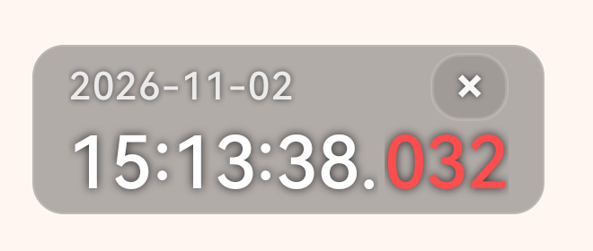

# 毫秒悬浮时钟

一款轻量的 Android 悬浮时钟应用。在其他应用上方显示日期和精确到三位毫秒的系统时间，支持拖动位置，并用红色突出毫秒读数。

[下载最新版本](https://github.com/bsxucome/milli-clock-overlay/releases/latest) · [查看全部版本](https://github.com/bsxucome/milli-clock-overlay/releases)

## 主要功能

- **悬浮显示**：通过悬浮窗显示时钟，便于使用其他应用时查看时间。
- **日期与时间分行**：日期格式为 `yyyy-MM-dd`，时间格式为 `HH:mm:ss.SSS`。
- **红色毫秒**：毫秒部分以红色单独显示，方便辨认。
- **拖动定位**：按住悬浮时钟拖动，即可调整位置。
- **轻点关闭**：轻点悬浮时钟显示右上角的「×」，再次点击「×」停止时钟；关闭按钮约 2.2 秒后自动隐藏。
- **前台运行**：使用前台服务维持时钟运行，适配 Android 14 及以上版本的前台服务要求。

## 界面截图

以下为 **v1.1.3 的真机截图**，已裁去系统状态栏和底部空白；时钟数值仅代表截图时的设备时间。

| 应用主界面 | 悬浮时钟运行效果 |
| :---: | :---: |
|  |  |
| 查看悬浮窗权限状态，启动或停止时钟。 | 时钟已拖动至界面下方空白区域，日期、时分秒和红色毫秒清晰可见。 |

**关闭按钮示例**：轻点悬浮时钟后，右上角显示「×」，点击即可关闭悬浮窗。



## 安装与使用

1. 打开[最新版本发布页面](https://github.com/bsxucome/milli-clock-overlay/releases/latest)，下载附件中的 `.apk` 文件并安装。
2. 首次打开应用，点击「授予悬浮窗权限」，在系统设置中允许应用显示在其他应用上层。
3. 返回应用，点击「启动悬浮时钟」。如系统请求通知权限，请按需允许。
4. 按住时钟拖动到合适位置。需要关闭时，轻点时钟，再点击右上角的「×」，或回到应用点击「停止悬浮时钟」。

**运行要求**：Android 8.0（API 26）及以上版本。

## 权限与使用说明

| 权限 | 用途 |
| --- | --- |
| `SYSTEM_ALERT_WINDOW` | 在其他应用上方显示悬浮时钟，需用户手动授权。 |
| `FOREGROUND_SERVICE` | 以前台服务运行悬浮时钟。 |
| `FOREGROUND_SERVICE_SPECIAL_USE` | 满足新版 Android 对特殊用途前台服务的要求。 |
| `POST_NOTIFICATIONS` | 在支持该权限的系统上显示运行通知。 |

- 部分系统设置、权限管理和安全页面会主动隐藏第三方悬浮窗，属于系统限制。
- 时钟读取设备系统时间与系统时区；毫秒读数随屏幕帧刷新，不代表每毫秒绘制一次，也不提供独立的网络校时。
- 文件名包含 `unsigned` 的 APK 为未签名产物，需要签名后才能正常安装。

## 技术信息

| 项目 | 配置 |
| --- | --- |
| 开发语言 | Java 17 |
| 编译 SDK | Android SDK 35 |
| 最低 SDK | API 26（Android 8.0） |
| 目标 SDK | API 34（Android 14） |
| 应用包名 | `com.bsxu.milliclock` |
| 构建方式 | Gradle Wrapper |

## 本地构建

准备 JDK 17 和 Android SDK，并通过本地 `local.properties` 配置 SDK 路径。

在 Windows PowerShell 中构建调试版：

```powershell
.\gradlew.bat assembleDebug
```

构建发布版：

```powershell
.\gradlew.bat assembleRelease
```

Linux / macOS 可使用 `./gradlew assembleDebug` 或 `./gradlew assembleRelease`。

构建产物：

- 调试版：`app/build/outputs/apk/debug/app-debug.apk`
- 已签名发布版：`app/build/outputs/apk/release/app-release.apk`
- 未签名发布版：`app/build/outputs/apk/release/app-release-unsigned.apk`

仓库的 `gradle.properties` 中包含用于本地离线构建的 Windows `aapt2` 路径覆盖项。在其他电脑构建时，请按实际环境修改或移除 `android.aapt2FromMavenOverride`；GitHub Actions 会在 Linux 构建前自动移除该项。

## 发布签名

本地发布签名使用可选的 `keystore.properties`，可参考[配置模板](keystore.properties.example)：

```properties
storeFile=release-keystore.jks
storePassword=你的密钥库密码
keyAlias=你的密钥别名
keyPassword=你的密钥密码
```

`keystore.properties`、`release-keystore.jks` 和 `local.properties` 均已加入 Git 忽略规则。没有本地签名配置时，发布构建会生成未签名 APK。

## 自动构建与版本发布

- **持续集成**：向 `main` 分支推送代码或提交拉取请求时，自动构建并上传调试版 APK。
- **版本发布**：推送 `v*` 标签时，自动构建发布版 APK、生成 SHA-256 校验文件，并发布中文版本说明。

自动签名需要在仓库的 Actions 密钥设置中配置：

| 密钥名称 | 内容 |
| --- | --- |
| `ANDROID_KEYSTORE_BASE64` | 密钥库文件经 Base64 编码后的完整内容。 |
| `ANDROID_KEYSTORE_PASSWORD` | 密钥库密码。 |
| `ANDROID_KEY_ALIAS` | 签名密钥别名。 |
| `ANDROID_KEY_PASSWORD` | 签名密钥密码。 |

上述密钥缺失时，发布流程会生成未签名 APK。

版本号位于 `gradle.properties`：

- `APP_VERSION_CODE`：供 Android 识别更新顺序的整数版本代码。
- `APP_VERSION_NAME`：向用户显示的版本号。

发布步骤：

1. 更新两个版本字段，递增版本代码，并设置新的版本号。
2. 提交并推送修改。
3. 创建与版本号一致的标签，例如 `v1.1.4`，并推送到 GitHub。
4. 等待 GitHub Actions 完成构建，在版本发布页面检查 APK、校验文件和中文说明。

## 项目结构

```text
app/src/main/
  java/com/bsxu/milliclock/   # 应用界面与悬浮时钟服务
  res/                      # 布局、图标与多语言资源
.github/workflows/          # 持续集成与版本发布流程
docs/screenshots/           # 文档使用的真机截图
gradle/                    # Gradle Wrapper 配置
README.md                  # 项目说明
keystore.properties.example # 本地签名配置模板
```
