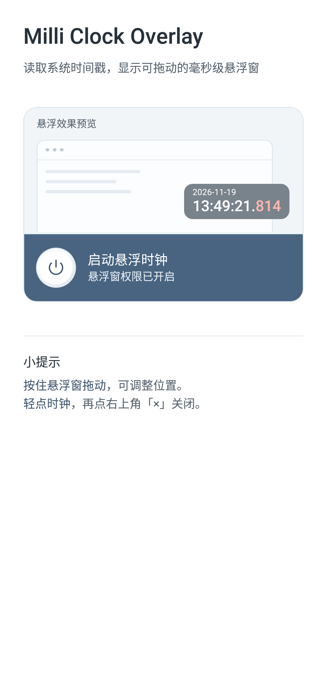
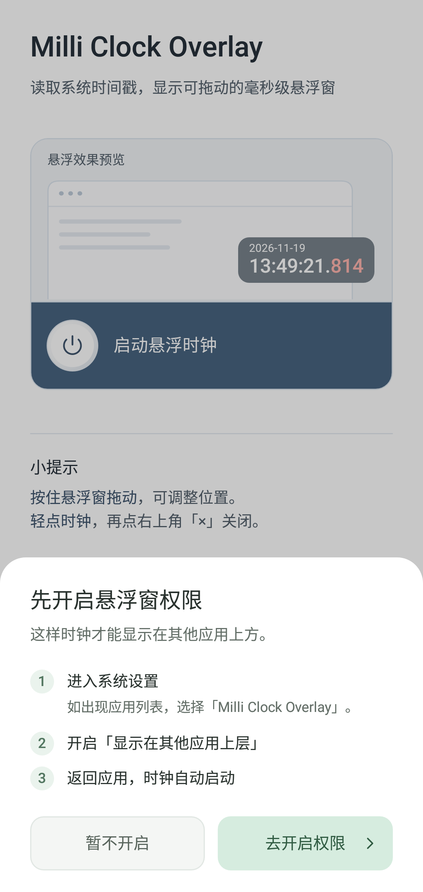
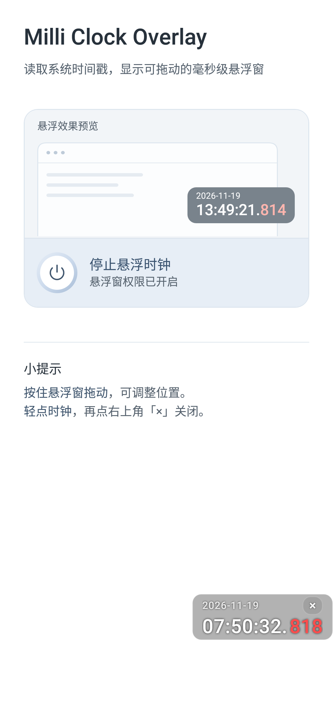
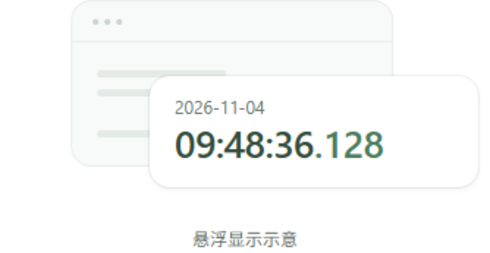

# 毫秒悬浮时钟

读取系统时间戳，显示可拖动的毫秒级悬浮窗。使用其他应用时，也能随时查看日期与时间。

[**下载最新版本**](https://github.com/bsxucome/milli-clock-overlay/releases/latest) · [v1.2.1 更新说明](https://github.com/bsxucome/milli-clock-overlay/releases/tag/v1.2.1)

支持 **Android 8.0 及以上版本**，旧版用户可直接覆盖安装。

## 主要功能

- **一键开关**。点击雾蓝色按钮启动时钟。运行时，按钮变成浅蓝色并显示「停止悬浮时钟」。
- **浮窗预览**。打开首页就能看到时钟悬浮在其他应用上方的样式。
- **毫秒显示**：日期与时间分行显示，毫秒部分以红色突出。
- **自由拖动**：按住悬浮窗拖动，放到合适的位置。
- **轻点关闭**：轻点时钟，再点右上角「×」关闭。
- **权限引导**：首次启动按步骤开启权限，返回应用即可自动启动时钟。

## 界面截图

以下为 v1.2.1 的实际界面。首页卡片里的时钟是样式示意，右图下方的浮窗显示截图时的设备时间。

| 应用首页 | 权限引导 | 运行状态 |
| :---: | :---: | :---: |
|  |  |  |

## 如何使用

1. 从[最新版本](https://github.com/bsxucome/milli-clock-overlay/releases/latest)下载 `.apk` 文件并安装。
2. 打开应用，点击「启动悬浮时钟」。首次使用时，点击「去开启权限」，在系统设置中开启「显示在其他应用上层」；如出现应用列表，选择「Milli Clock Overlay」。
3. 返回应用，时钟会自动启动。之后点击首页按钮，即可启动或停止。

## 小提示

- 按住悬浮窗拖动，可调整位置。
- 轻点时钟，再点右上角「×」关闭。也可以回到应用点击「停止悬浮时钟」。
- 时钟读取设备系统时间和时区，不另行进行网络校时。
- 部分系统设置和安全页面会隐藏第三方悬浮窗，这是系统行为。

悬浮显示示意

时钟显示在其他应用上方。下图为功能示意，实际样式见上方界面截图。

