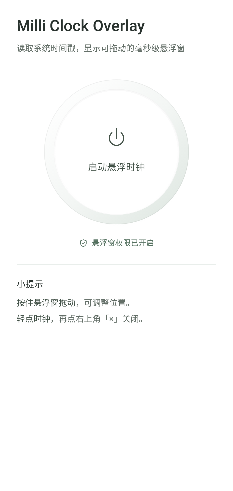
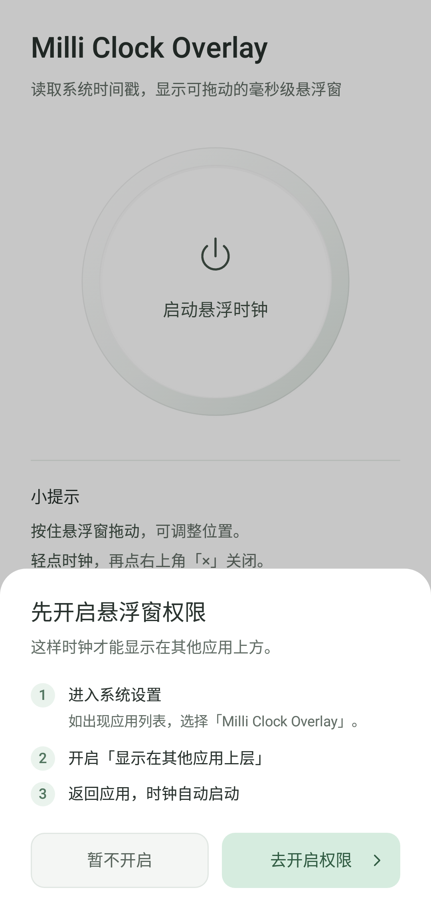
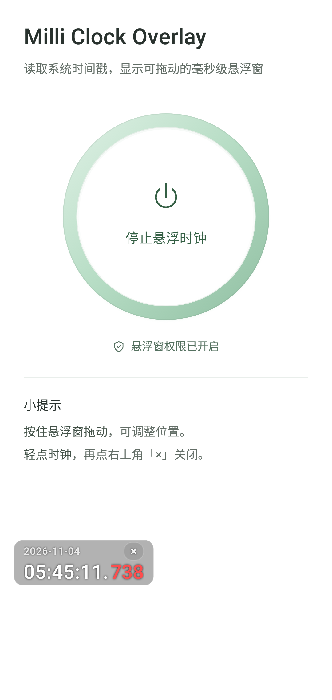

全新首页与权限引导，让悬浮时钟的开启和关闭更直观。

## 更新内容

- 首页采用纯白背景，启动与停止合并为一个圆环按钮：白色表示未开启，浅绿色表示运行中。
- 点击启动后按需显示权限引导，通过三个步骤说明如何开启悬浮窗权限；授权后返回应用，时钟自动启动。
- 优化权限说明的单行显示、步骤之间的视觉留白，以及两个操作按钮的尺寸与排版。
- 保留「小提示」和分隔线，清楚说明拖动与关闭方法。
- 改善大字体下的文字换行、按钮排列与页面滚动。
- 增加启动、停止悬浮时钟的广播入口，方便自动化工具调用。

## 界面预览

| 应用首页 | 权限引导 | 运行状态 |
| :---: | :---: | :---: |
|  |  |  |

## 安装与使用

下载附件中的 **Milli-Clock-Overlay-v1.2.0.apk** 安装，支持 Android 8.0 及以上版本。已安装旧版的用户可直接覆盖升级。

打开应用后点击圆环；首次使用按引导开启悬浮窗权限，返回应用即可启动时钟。按住悬浮窗可以拖动，轻点时钟后再点右上角「×」可以关闭。

[完整使用说明](https://github.com/bsxucome/milli-clock-overlay/blob/v1.2.0/README.md)
