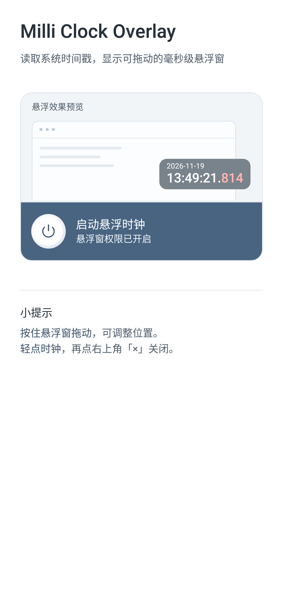
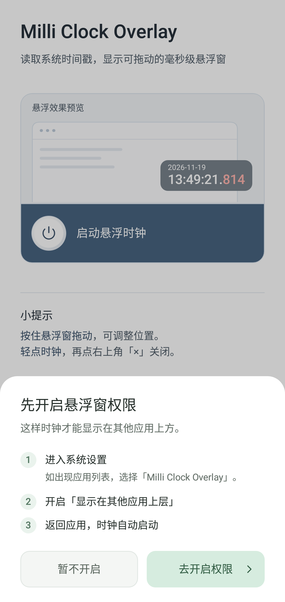
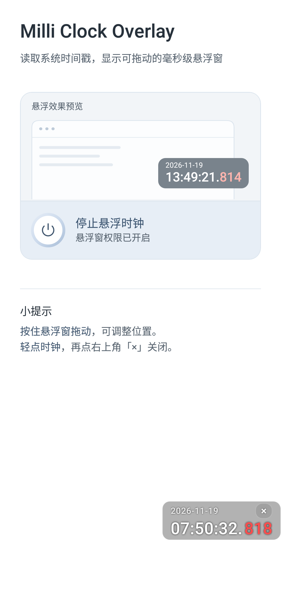

全屏首页换上雾蓝配色，让启动入口更清楚。

- 白色首页用一张卡片展示浮窗预览和横向开关，点击整条按钮即可操作。
- 启动按钮采用深雾蓝底和白字，运行后切换为浅蓝并显示「停止悬浮时钟」。
- 缩小卡片里的时钟示意，减弱红色毫秒的视觉强调，让按钮更容易找到。

| 未开启 | 权限引导 | 运行中 |
| :---: | :---: | :---: |
|  |  |  |

下载附件中的 **Milli-Clock-Overlay-v1.2.1.apk** 安装。支持 Android 8.0 及以上，旧版可直接覆盖升级。

[完整使用说明](https://github.com/bsxucome/milli-clock-overlay/blob/v1.2.1/README.md)
