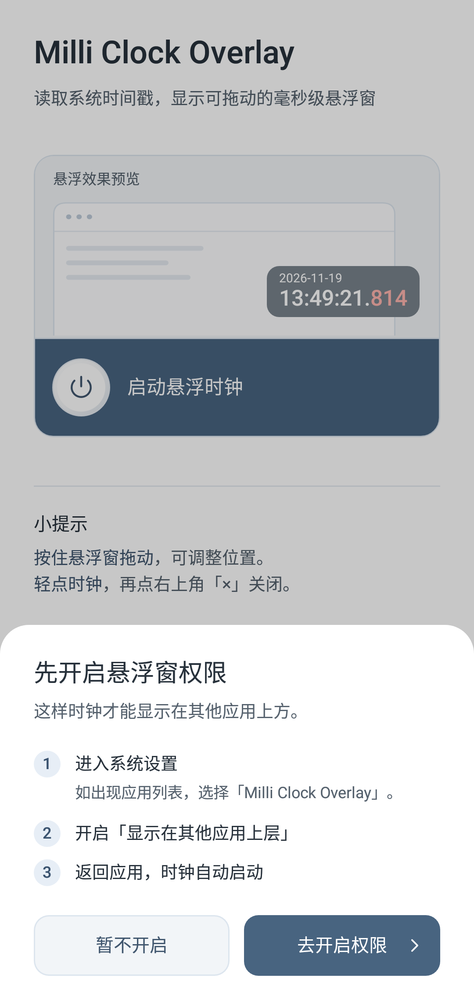

首次使用时，权限引导弹窗与首页采用同一套雾蓝配色。

- 「去开启权限」使用深雾蓝底、白字和白色箭头，更容易找到。
- 三个步骤编号使用浅雾蓝，「暂不开启」按钮使用浅灰蓝。

下载附件中的 **Milli-Clock-Overlay-v1.2.2.apk** 安装。支持 Android 8.0 及以上，旧版可直接覆盖升级。

[完整使用说明](https://github.com/bsxucome/milli-clock-overlay/blob/v1.2.2/README.md)
