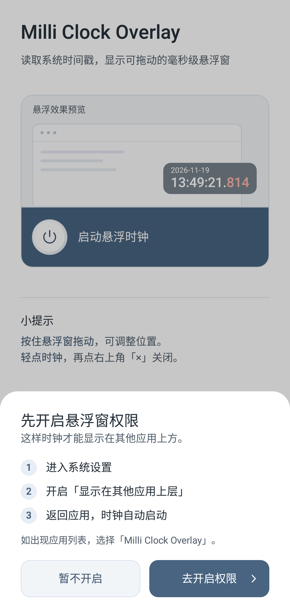

调整首次使用的悬浮窗权限引导排版。

- 三个授权步骤等距排列，应用列表提示单独放在按钮上方。
- 缩小主标题与用途说明的间距，让两行文字读起来更连贯。

下载附件中的 **Milli-Clock-Overlay-v1.2.3.apk** 安装。支持 Android 8.0 及以上，旧版可直接覆盖升级。

[完整使用说明](https://github.com/bsxucome/milli-clock-overlay/blob/v1.2.3/README.md)
